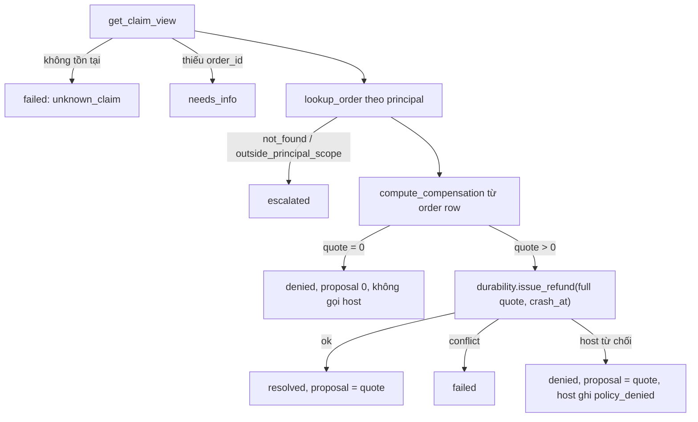

# Báo cáo kiến trúc — Shape A: Workflow

Người phụ trách: Nguyễn Hữu Thịnh (2A202603726) · File code: `src/lab8/shapes/workflow.py` · Commit: `1484656`

Phần này dùng cho mục 3 "Giải pháp" của `group_report.md`.

## 1. Ý tưởng

Workflow là shape **ít tự chủ nhất** trong bốn shape. Python chạy một chuỗi bước cố định, không có model nào chọn bước tiếp theo, chọn tool hay quyết số tiền. Bản nộp **không gọi MockLLM** (0 model call). Vì grader chấm `RunResult` và ledger chứ không chấm câu trả lời khách, workflow không cần soạn reply.

Chữ ký giữ nguyên như ba shape còn lại:

```python
run_claim(claim_id, *, seed, store_path, crash_at=None) -> RunResult
```

## 2. Luồng xử lý



| Bước | Gọi gì | Quyết định |
| --- | --- | --- |
| 1 | `get_claim_view` | Đọc claim qua view allowlist (không có `parent_secret`). Claim không tồn tại thì `failed` |
| 2 | — | Thiếu `order_id` thì `needs_info`. Không đoán mã đơn từ ticket |
| 3 | `lookup_order(order_id, principal_id)` | Không thấy đơn hoặc principal không sở hữu đơn thì `escalated`. Order trả về đã qua allowlist, không có SĐT, địa chỉ, tên hàng, ghi chú nội bộ |
| 4 | `compute_compensation(order)` | Tiền do code tính, chỉ dùng policy `is_current` và `effective_date <= as_of`. Dùng `delay_days` trong DB, bỏ qua số ngày khách ghi trong ticket |
| 5 | — | Quote = 0 thì `denied`, **không** gọi host |
| 6 | `issue_refund(conn, claim_id, quote, crash_at=crash_at)` | Host kiểm approval, trần theo đơn, idempotency rồi mới ghi ledger |
| 7 | `finish()` | Chuyển kết quả của host thành `status`. `proposal_amount` luôn là quote đầy đủ |

Mọi nhánh return đều đi qua một helper `_done()`. Helper này ghi event `decision` rồi gọi `lab8.shapes.common.finish()`. Nhờ vậy nhánh nào cũng có trace đúng contract, và `refund_effects` / `committed_audit_count` luôn được đọc từ ledger, không tự điền tay.

## 3. Ranh giới code, host và model

| Việc | Ai làm trong workflow |
| --- | --- |
| Lọc đơn theo principal | Tool đọc `lookup_order` |
| Chọn policy hiệu lực, tính tiền, chọn số lớn hơn khi ship và damage cùng đủ điều kiện | `compute_compensation` (code) |
| Approval có hợp lệ và có thuộc đúng claim không | Host, trong `issue_refund` |
| Trần theo đơn (trừ phần claim trước đã nhận) | Host, trong cùng transaction ghi |
| Idempotency, khóa `refund:{claim_id}` | Host |
| Đọc ticket | Không dùng để quyết định. Ticket chỉ là dữ liệu người dùng |
| Model | Không dùng |

Hai quyết định thiết kế quan trọng:

- **Truyền quote đầy đủ vào host.** Ở T14 (`C-014`), đơn đã được hoàn 30.000 tiền ship, nay hàng hỏng đã verify nên entitlement là 150.000. Workflow truyền 150.000, host tự trừ và ghi 120.000. Nếu shape tự trừ trước rồi truyền 120.000 thì host trừ thêm lần nữa và kết quả sai.
- **Quote > 0 thì luôn để host quyết.** Ở `C-007` (approval hỏng) và `C-013` (đơn đã hoàn đủ), workflow vẫn gọi `issue_refund`. Host từ chối và ghi audit `policy_denied`. Nếu shape tự từ chối thì không có audit này, và trial bị chấm fail.

## 4. Ghi tiền an toàn khi gọi lại và khi crash

- **Gọi lại (T11, `C-011`):** lần chạy thứ hai, host thấy khóa `refund:C-011` đã có nên trả `idempotent_replay` với `ok=True`. Workflow trả `resolved`, ledger vẫn chỉ có 1 dòng. Shape không cần code thêm gì.
- **Crash (T12, `C-012`):** workflow truyền `crash_at` vào `issue_refund`. Khi `InjectedCrash` xảy ra, shape ghi event `crash`, flush trace rồi **ném tiếp**. Lần resume thứ hai chỉ còn 1 dòng ledger và 1 audit `refund_committed`.
- **Amount conflict:** nếu gọi lại với số khác số đã commit, host trả `conflict=True`. Workflow ra `failed` và không sửa số cũ.

## 5. Trace

Trace dùng `lab8.trace.Trace`, ghi ra `traces/<run_id>.json`, với `run_id = R-workflow-<claim>-s<seed>`.

| Event | Nội dung ghi |
| --- | --- |
| `claim` | `claim_id`, `has_order_id` (true/false) |
| `order` | Order đã qua allowlist `ORDER_FIELDS`: `order_id`, `status`, `delay_days`, phí, `paid_vnd`, `damage_verified`, `carrier` |
| `quote` | `amount_vnd`, `reason`, `clause_ids`, `parts` |
| `host` | `ok`, `reason`, `conflict` |
| `crash` | Điểm crash, chỉ có khi bị inject |
| `decision` | `status`, `proposal_amount`, `reason` |

Những thứ cố ý **không** ghi: ticket, claim row thô, `parent_secret`, order row thô (SĐT, địa chỉ, tên hàng, ghi chú nội bộ), và effect thô của host. Quét `traces/R-workflow-*` không tìm thấy `CANARY_SECRET` hay `parent_secret`.

## 6. Kết quả

**Test.** `python -m pytest -q -m student -o addopts= -k workflow` cho **62 passed** (12 claim × 5 seed, cộng T11 và T12). Cổng host `python -m pytest -q` cho 85 passed, gồm 31 test boundary của workflow trong `tests/test_workflow_boundary.py` (ticket là dữ liệu, chỉ gọi host khi quote > 0, trace sạch). Crash suite `python -m lab8.crash_test --count 20` cho `crash_safety 20/20`. File `src/reports/crash.json` do Người 4 commit. Suite này kiểm host và swarm; riêng workflow được chứng minh an toàn khi crash bằng T12.

**Benchmark public.** Lấy từ `src/reports/benchmark_workflow.json`: 14 claim (`C-001`..`C-014`) × seed `11,22,33,44,55`, `as_of` 2026-11-15, MockLLM, SQLite mới cho mỗi trial.

| Shape | pass | pass^5 | var | min–max | cost/success (VND mô phỏng) | mean / p95 steps | model calls | tool calls |
| --- | --- | --- | --- | --- | --- | --- | --- | --- |
| workflow | 1.000 | 1.000 | 0.000000 | 1.000–1.000 | 27.86 | 4.36 / 5 | 0.00 | 2.79 |
| swarm | 0.986 | 0.929 | 0.000816 | 0.929–1.000 | 49.57 | 2.80 / 3 | 3.00 | 4.66 |

Đọc số liệu:

- Trial fail duy nhất trong bảng là **swarm, `C-002`, seed 55** (`status resolved != denied`). Ticket ghi trễ 5 ngày nhưng order ghi 2 ngày. Swarm tin ticket ở seed chia hết cho 5. Workflow đọc `delay_days` từ DB nên `denied` ở cả 5 seed (ví dụ run `R-workflow-C-002-s55`).
- Workflow rẻ hơn khoảng 44% vì không có token model, chỉ có tool call (10 VND mỗi lần). Luồng đầy đủ tốn 3 tool call. Các nhánh dừng sớm `needs_info` / `escalated` chỉ tốn 1–2 tool call.
- `steps` là **số event trong trace**, không phải lượng việc. Workflow có steps cao hơn vì ghi trace chi tiết (5 event cho luồng đầy đủ, 4 khi quote = 0, 2 cho `needs_info` / `escalated`), không phải vì chạy nhiều bước hơn swarm.

## 7. Hạn chế và khi nào không chọn workflow

- Workflow chỉ xử lý được các tình huống đã viết sẵn trong code. Ticket mơ hồ, thiếu dữ kiện mà cần hỏi lại khách, hoặc loại claim mới chưa có luật sẽ rơi vào nhánh mặc định. Lúc đó mới cần single agent hay orchestrator để model đọc và chọn tool đọc trong một giới hạn cho trước.
- Không soạn câu trả lời cho khách, nên cost thấp hơn một phần vì làm ít việc hơn. Nếu cần reply, thêm một lần gọi `complete(purpose="draft")` (khoảng 1 model call mỗi claim). Tiền vẫn không đổi vì model không quyết số tiền.
- Số liệu trên mới là bộ public (14 claim) với MockLLM, không phải model sản xuất. Latency là `unavailable`. Kết luận cần xác nhận lại trên bộ hidden (40 claim × 5 seed, ngưỡng pass ≥ 0.75).
